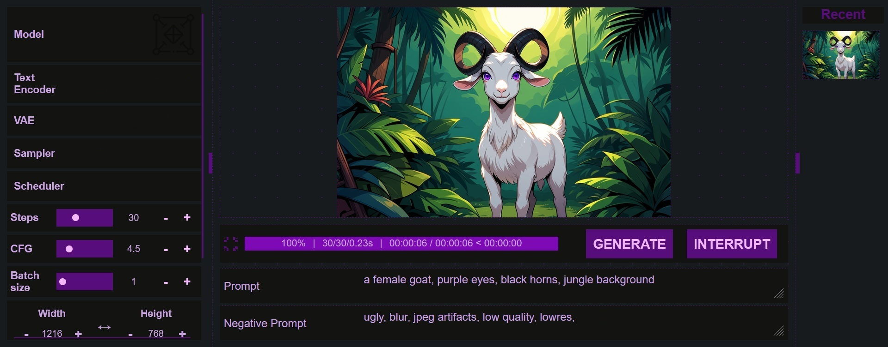

<!-- Improved compatibility of back to top link: See: https://github.com/othneildrew/Best-README-Template/pull/73 -->
<a name="readme-top"></a>
<br />
<div align="center">

  <h1 align="center">Flow - Streamlined Way to ComfyUI</h1>
  <h4 align="center"><em>Let your creativity flow naturally</em></h4>
  
  <h4 align="center">Don't forget to leave a star</h4>
  
</div>

## About The Project

Flow is a custom node designed to provide user-friendly interface for ComfyUI by acting as an alternative user interface for running workflows It is not a replacement for workflow creation.

The is a personal fork of Flow i remove flows i found that was useless or not really used as there is better diffusions around like dropping Hunyuan because MiniMax H3 does a way better job i will try to add stuff overtime when i dabble with ComfyUI with the latest diffusions

### Improvements In This Fork
- [x] Ability to add and remove LoRAs in flows
- [x] Support for Anima, SD, SDXL, Krea2, Z-Image, MiniMax H3
- [x] Removed Cogvideox, Flux, Mochi, Hunyuan, Omnigen
- [x] Removed the forced auto updater might re-add later
- [x] Made the previews for flows cleaner that be images or prompts
- [ ] Add AceStep 1.5 XL support
- [ ] Add Qwen TTS/Voice Cloning
- [ ] Add VoiceVibe TTS/Voice Cloning


#### Requirements
 - [ComfyUI](https://github.com/Comfy-Org/ComfyUI)
 - [ComfyUI-Manager? i do not know how to add it too the list so if someone can add it for me feel free](https://github.com/Comfy-Org/ComfyUI-Manager)
 
<!-- INSTALLATION -->
## Installation

1. Click on the Green `Code` button then click on `Download Zip`
2. Extract the content of the zip into `ComfyUI/custom_nodes/comfyui-manager`

To run Flow, navigate to this address bar in your web browser:
```bash
http://127.0.0.1:8188/flow
```
<p align="right">(<a href="#readme-top">back to top</a>)</p>
