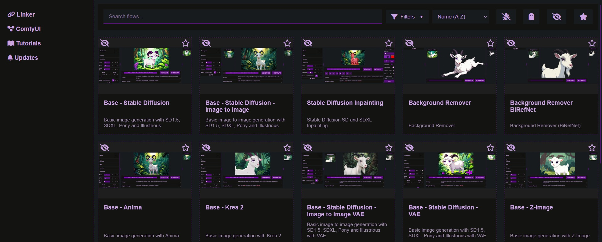
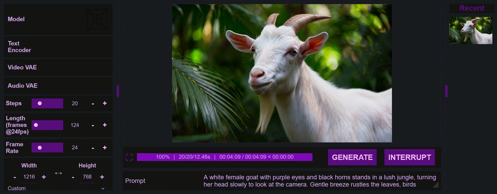
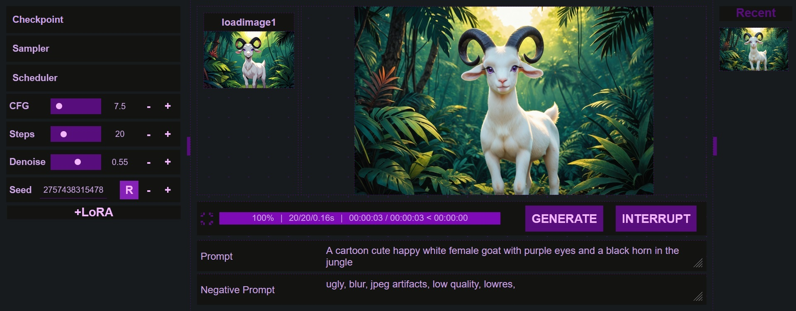

<!-- Improved compatibility of back to top link: See: https://github.com/othneildrew/Best-README-Template/pull/73 -->
<a name="readme-top"></a>
<br />
<div align="center">

  <h1 align="center">Flow - Streamlined Way to ComfyUI</h1>
  <h4 align="center"><em>Let your creativity flow naturally</em></h4>
  <h4 align="center">Don't forget to leave a star.</h4>
  
</div>

## About The Project

Flow is a custom node designed to provide user-friendly interface for ComfyUI by acting as an alternative user interface for running workflows. It is not a replacement for workflow creation.

Flow is currently in the early stages of development, so expect bugs and ongoing feature enhancements. With your support and feedback, Flow will settle into a steady stream.







<p align="right">(<a href="#readme-top">back to top</a>)</p>

#### Requirements
 - [ComfyUI](https://github.com/Comfy-Org/ComfyUI)
 - [ComfyUI-Manager?](https://github.com/Comfy-Org/ComfyUI-Manager)
 
<!-- INSTALLATION -->
## Installation

```bash
git clone https://github.com/BansheeStudio/ComfyUI-disty-Flow
```

To run Flow, navigate to this address in your web browser:

```bash
http://127.0.0.1:8188/flow
```

<p align="right">(<a href="#readme-top">back to top</a>)</p>

### Improvements From This Fork
- [x] Able to remove LoRAs
- [x] Support for Anima, Krea2, Z-Image, MiniMax H3
- [x] Removed old video diffusions flows just use MiniMax H3
- [x] Removed the forced auto updater

<p align="right">(<a href="#readme-top">back to top</a>)</p>

